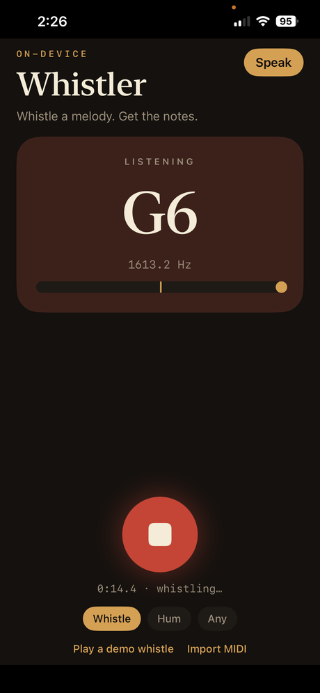

# Whistler

> Whistle a melody, get notes, tab, and a MIDI file. The pitch stays on your phone.

<p align="center">
  
</p>

## What it does

Whistle a melody you made up. Whistler transcribes it on-device into notes, a piano roll, staff, guitar tab, and a MIDI file.

**iOS is the app.** The Next.js site in this repo is a scratchpad for the pitch math. Use the phone.

This is **not** Google’s hum-to-search. That product matches a whistle against a catalog of existing songs. Whistler has no catalog. It listens for pitch and writes down what you actually whistled.

## Quickstart

**Requirements:** a Mac with Xcode 15+, [XcodeGen](https://github.com/yonaskolb/XcodeGen) (`brew install xcodegen`), and an iPhone (the microphone needs a real device). The web scratchpad needs Node 20+.

## iPhone

```bash
cd ios
make open
```

That generates the Xcode project and opens it. Plug in your iPhone, pick it as the run destination, hit Run. First launch will ask for the microphone.

To run on your own device you need your own Apple team and device ids:

```bash
xcrun devicectl list devices
make device DEVICE_UDID=<udid> DEVICE_CORE=<coredevice-id> DEVELOPMENT_TEAM=<apple-team-id>
```

The bundle id `com.nightmoose.whistler` is ours; change it in `ios/project.yml` if you sign with a different team.

Or from the same folder:

```bash
make test
make build
```

Whistle into the big button. Stop. Share the MIDI into Files, Mail, or a DAW. Tap a note in the roll if the detector guessed wrong.

**Speak** (top right) types a line and how to say it. Grok writes a 48 kHz WAV you can play or share into a session. The API key is saved in the phone’s keychain the first time. The whistle itself still never leaves the phone.

**Import MIDI** from Files (or share a `.mid` into Whistler). It loads the notes, shows staff/tab, and plays them. Drum tracks are skipped.

Source modes: **Whistle** (default, 480 Hz–4.2 kHz), **Hum**, **Any**.

## Example

Tap the big button, whistle a few bars of a tune you invented, tap stop. You get a piano roll, staff, and guitar tab. Share the `.mid` into Files, Mail, or a DAW.

## Tips

- Quiet room, phone a foot away
- Hold each pitch about a beat; leave a sliver of silence between notes
- Heavy vibrato smears a note
- Guitar tab is shifted down into a playable octave when the whistle sits above the neck

## Web scratchpad

```bash
npm install
npm test
npm run dev
```

Safari on a phone will **not** get the microphone over plain `http://` on the LAN. Don’t bother with the web app on iOS unless it is served over HTTPS.

## License

[MIT](./LICENSE) © 2026 NightMoose, Inc.

Whistler is not affiliated with Google or xAI. "Grok" is a trademark of xAI.
